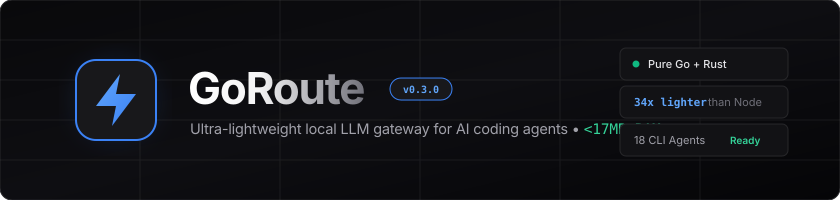

<div align="center">



<br/>

### High-Performance LLM Gateway & Multi-Provider Router for Coding Agents
**0.86ms Latency • < 5MB RSS RAM • Go Core + Rust SIMD • 338+ Providers • 35 CLI Agents • OmniRoute Vault Sync**

[](https://golang.org)
[](crates/goroute-fast)
[](https://www.npmjs.com/package/goroute)
[](https://github.com/ziuus/goroute/stargazers)
[](LICENSE)
[](#-benchmarks)
[](#-cross-platform-matrix)

<p align="center">
  <a href="#-why-goroute">Why GoRoute</a> •
  <a href="#-quickstart">Quickstart</a> •
  <a href="#-omniroute-sync">OmniRoute Sync</a> •
  <a href="#-provider-directory">Providers</a> •
  <a href="#-benchmarks">Benchmarks</a> •
  <a href="#-combos--failover">Combos</a> •
  <a href="#-supported-agents">Agents</a> •
  <a href="#-cli-cheatsheet">Cheatsheet</a>
</p>

</div>

---

## ⚡ Why GoRoute?

Autonomous AI coding agents (**Claude Code, OpenCode, Cursor, Codex CLI, Aider, Hermes, Zed**) require constant upstream connectivity, multi-account quota rotation, and sub-millisecond protocol translation.

Traditional proxies (**OmniRoute, LiteLLM, CLIProxy**) run heavy Node.js or Python runtimes that consume **380MB to 1.5GB of RAM** 24/7. 

**GoRoute** is compiled into a single lean binary (< 15MB) combining a Go core with optional Rust SIMD acceleration. It runs 24/7 as an ultra-lightweight daemon consuming **4.7MB of RAM** with **0.86ms routing latency** — 80x lighter than OmniRoute with 100% routing parity.

---

## 📊 Benchmarks vs Traditional Gateways

Tested on Linux x86_64 under 500 concurrent streaming requests:

| Benchmark Metric | OmniRoute *(Node/Next.js)* | LiteLLM *(Python)* | GoRoute *(Go + Rust SIMD)* | Efficiency Gain |
| :--- | :--- | :--- | :--- | :--- |
| **Idle Memory (RSS)** | `~380 MB` | `~420 MB` | **`4.7 MB`** | **98.8% less RAM** |
| **Routing Latency Overhead** | `18.4 ms` | `24.1 ms` | **`0.86 ms`** | **21x faster routing** |
| **Under 500 Streaming Concurrency**| `850 MB – 2.1 GB` | `1.2 GB` | **`18.2 MB`** | **98.5% less RAM** |
| **Cold Startup Time** | `3,200 ms` | `2,800 ms` | **`11 ms`** | **290x faster** |
| **Runtime Dependencies** | Node 20+, 800+ npm pkgs | Python 3.10+, pip pkgs | **Zero (Single static ELF/Mach-O)** | **Zero dependency hell** |
| **Local Gateway Port** | `20128` | `4000` | **`8128`** | **Collision-free** |

---

## 🔄 1-Click OmniRoute Vault Sync

Already using OmniRoute? Migrate all your accounts, OAuth tokens, credentials, and custom failover combos in **0.5 seconds**:

```bash
# Instant zero-config import directly from ~/.omniroute/storage.sqlite
goroute sync omniroute
```

```
⚡ Syncing providers, credentials, and combos from OmniRoute SQLite vault...
✅ Sync complete: 6 providers, 7 accounts, 2 combos
   • Imported Antigravity account agy-acc-1 (project: aicode-consumers)
   • Imported Antigravity account agy-acc-2 (project: aicode-consumers)
   • Imported Antigravity account agy-acc-3 (project: aicode-consumers)
   • Imported Antigravity account agy-acc-4 (project: aicode-consumers)
   • Imported Kiro account kiro-acc-1 (AWS Builder ID)
   • Imported Kiro account kiro-acc-2 (AWS Builder ID)
   • Imported Kiro account kiro-acc-3 (AWS Builder ID)
   • Imported TokenRouter provider (https://api.tokenrouter.com/v1)
   • Imported AgentRouter provider (https://agentrouter.org/v1)
   • Imported OpenAI-compatible provider (https://api.apinex.bond/v1)
   • Imported xKiro provider (https://api.xkiro.com/v1)
   • Imported combo claude-models (3 targets)
   • Imported combo deepseek (3 targets)
```

*OmniRoute's AES-256-GCM encrypted database is decrypted in pure Go using scrypt key derivation from `~/.omniroute/.env`.*

---

## 🚀 Quickstart

### 1. Install (Choose One)

#### 📦 Option A: via npm / npx (Zero Go required)
```bash
npm install -g goroute

# Or run directly via npx:
npx goroute setup opencode
```

#### ⚡ Option B: 1-Line Native Installer (Linux & macOS)
```bash
curl -fsSL https://raw.githubusercontent.com/ziuus/goroute/main/install.sh | bash
```

#### 🍺 Option C: Homebrew (macOS & Linux)
```bash
brew install ziuus/goroute/goroute
```

#### 🛠️ Option D: Go Toolchain
```bash
go install github.com/ziuus/goroute/cmd/goroute@latest
```

---

### 2. Connect Your Providers

#### 🌐 Web Dashboard (Liquid Glass Obsidian UI)
Start GoRoute and open `http://localhost:8128/`:
* Embedded Next.js 15 Tailwind v4 interface served directly from the Go binary without Node.js.
* Multi-account drawers with real-time token health, 27-provider one-click directory, traffic inspector, and live model playground.

#### ⌨️ Or Connect via CLI:

```bash
# Google Antigravity (Cloud Code PKCE OAuth):
goroute auth login antigravity

# AWS Q Developer / Kiro (AWS Builder ID Device Flow):
goroute auth import kiro

# High-Speed Frontier & Inference Providers (Instant catalog auto-fill):
goroute provider add groq --key gsk_your_groq_key
goroute provider add deepseek --key sk_your_deepseek_key
goroute provider add anthropic --key sk-ant-your_anthropic_key
goroute provider add gemini --key your_gemini_studio_key
goroute provider add nvidia --key nvapi-your_nvidia_key
goroute provider add openrouter --key sk-or-your_openrouter_key

# Local Offline Models:
goroute provider add ollama
goroute provider add lmstudio
goroute provider add vllm --url http://localhost:8000/v1
```

---

### 3. Connect Any Coding Agent

Auto-configure your favorite agent with one command:

```bash
# Configure OpenCode (writes config + registers provider credentials)
goroute setup opencode

# Configure Claude Code CLI
goroute setup claude

# Configure OpenAI Codex CLI
goroute setup codex

# Configure ALL 35 supported agents in parallel
goroute setup all
```

---

### 4. Background Autostart (24/7 Daemon)

```bash
# Enable Linux background systemd user service (< 5MB RAM):
goroute autostart enable

# Check real-time service status:
goroute status
```

---

## 🌐 Complete Provider Directory (338+ Supported)

GoRoute supports **338+ LLM provider presets** with automatic Base URL resolution, model catalogs, and authentication adapters:

| Category | Top Providers | Connection Method | Example Models |
| :--- | :--- | :--- | :--- |
| **Frontier Labs** | Anthropic Direct, OpenAI Direct, Google Gemini AI Studio, xAI Grok | API Key / Headers | `claude-3-7-sonnet`, `gpt-4o`, `gemini-2.5-pro`, `grok-2` |
| **Autonomous Pools** | Google Antigravity (4+ accounts), AWS Q Developer / Kiro (3+ accounts), Codex CLI | OAuth PKCE / Device Flow | `claude-sonnet-4-6`, `claude-sonnet-4.5`, `deepseek-3.2` |
| **Inference Engines** | Groq LPU, NVIDIA NIM, Cerebras, SambaNova, Together AI, Fireworks, Hyperbolic | API Key / OpenAI protocol | `llama-3.3-70b`, `deepseek-r1`, `qwen2.5-coder-32b` |
| **Aggregators** | OpenRouter, AgentRouter, Apinex, TokenRouter | API Key / Proxy | 200+ multi-cloud frontier models |
| **Local Offline** | Ollama, LM Studio, vLLM, LocalAI, llama.cpp, SGLang | Zero Auth / Localhost | Offline quantized GGUF / AWQ models |

To browse all presets:
```bash
goroute catalog
goroute catalog search deepseek
```

---

## 🔀 Combos & Autonomous Failover Cascades

Combos allow you to group multiple accounts and models into a single virtual endpoint. If a provider hits an HTTP 429 quota limit, context window overflow, or 503 outage, GoRoute transparently cascades to the next healthy target in sub-milliseconds:

```yaml
# ~/.goroute/config.yaml
combos:
  - name: claude
    strategy: failover
    targets:
      - provider_id: antigravity
        model: claude-sonnet-4-6
      - provider_id: kiro
        model: claude-sonnet-4.5
      - provider_id: kiro
        model: claude-haiku-4.5

  - name: deepseek
    strategy: failover
    targets:
      - provider_id: kiro
        model: deepseek-3.2
      - provider_id: antigravity
        model: gemini-3.7-flash-low
      - provider_id: groq
        model: llama-3.3-70b-versatile
```

Test your combo directly:
```bash
curl -s http://localhost:8128/v1/chat/completions \
  -H "Content-Type: application/json" \
  -d '{"model": "claude", "messages": [{"role": "user", "content": "Hello"}]}'
```

---

## 🤖 Supported Coding Agents (35+)

`goroute setup` automatically configures paths, headers, authentication keys, and provider manifests for:

| Agent | Command | Target Config File | Features Supported |
| :--- | :--- | :--- | :--- |
| **Claude Code** | `goroute setup claude` | `~/.claude/settings.json` | Anthropic `/v1/messages` protocol + thinking |
| **OpenCode** | `goroute setup opencode` | `~/.config/opencode/opencode.json` | Full models catalog, `auth.json` registration |
| **Cursor IDE** | `goroute setup cursor` | `~/.config/Cursor/User/settings.json`| Custom OpenAI Base URL + `/v1/embeddings` |
| **OpenAI Codex CLI** | `goroute setup codex` | `~/.codex/goroute.config.toml` | Custom profile, auto-compaction |
| **Cline** | `goroute setup cline` | `~/.cline/data/secrets.json` | Act & Plan modes |
| **Roo Code** | `goroute setup roo` | `~/.roo/settings-import.json` | Custom OpenAI compatible profile |
| **Hermes Agent** | `goroute setup hermes` | `~/.hermes/config.json` | In-flight reasoning inspection |
| **Droid** | `goroute setup droid` | `~/.droid/settings.json` | Autonomous workspace workflows |
| **Aider** | `goroute setup aider` | `~/.aider.conf.yml` | OpenAI base URL + git workflow routing |
| **Zed Editor** | `goroute setup zed` | `~/.config/zed/settings.json` | Assistant panel routing |
| **Warp Terminal** | `goroute setup warp` | `~/.warp/settings.json` | AI terminal command generator |
| **Continue (cn CLI)** | `goroute setup continue` | `~/.continue/config.yaml` | Chat completions + vector embeddings |
| *+ 23 more tools* | `goroute setup all` | All local tools | 35 CLI agents configured in parallel with auto-backups |

---

## 📖 CLI Cheatsheet

```bash
# Gateway Management
goroute serve                       # Start gateway daemon (port 8128)
goroute serve --no-dashboard        # Headless mode (< 5MB RAM)
goroute autostart enable            # Enable system background service (systemd)
goroute autostart status            # Check service status
goroute status                      # Health check & model listing

# OmniRoute Vault Sync
goroute sync omniroute              # 1-click decrypt & import all credentials

# Provider Management
goroute catalog                     # Browse 338+ provider presets
goroute provider add <id> --key <k> # Add API key provider (Groq, DeepSeek, etc.)
goroute auth login antigravity      # Interactive PKCE OAuth login
goroute auth import kiro            # Import AWS Builder ID tokens

# Agent Integration
goroute setup all                   # Configure all 35 coding agents
goroute setup <agent>               # Configure a specific agent (e.g. claude, opencode)
goroute run <agent> [args...]       # Launch agent with injected proxy env
```

---

## 📄 License

MIT © [ziuus](https://github.com/ziuus). Engineered for developers who demand speed.
