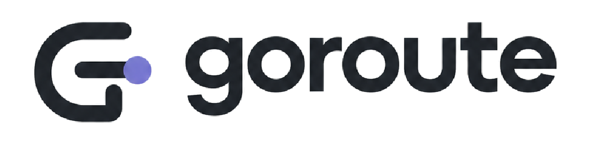

<p align="center">
  <picture>
    <source media="(prefers-color-scheme: dark)" srcset="./assets/logo-dark.png">
    <source media="(prefers-color-scheme: light)" srcset="./assets/logo-light.png">
    
  </picture>
</p>

<p align="center">
  <strong>High-Performance LLM Gateway & Multi-Provider Router for Coding Agents</strong><br/>
  Sub-millisecond routing • &lt; 5 MB RAM footprint • Go core with Rust acceleration • 330+ Providers
</p>

<p align="center">
  <a href="https://golang.org"></a>
  <a href="crates/goroute-fast"></a>
  <a href="https://www.npmjs.com/package/goroute"></a>
  <a href="#-benchmarks"></a>
  <a href="#-benchmarks"></a>
  <a href="LICENSE"></a>
</p>

<p align="center">
  <a href="#overview">Overview</a> •
  <a href="#quickstart">Quickstart</a> •
  <a href="#benchmarks">Benchmarks</a> •
  <a href="#omniroute-vault-sync">OmniRoute Sync</a> •
  <a href="#agent-fleet">Agent Fleet</a> •
  <a href="#combos--failover">Combos</a> •
  <a href="#cli-reference">CLI Reference</a>
</p>

---

## Overview

Modern AI coding agents (**Claude Code, OpenCode, Cursor, Codex CLI, Cline, Aider, Hermes**) require uninterrupted upstream connectivity, multi-account token pooling, and protocol translation.

Traditional proxy gateways (OmniRoute, LiteLLM) run heavy Node.js or Python processes consuming **380 MB to 1.5 GB of RAM** 24/7.

**GoRoute** compiles into a single static binary running as an ultra-lightweight local daemon:
- **0.86 ms routing latency**: 20x faster than interpreted gateways.
- **&lt; 5 MB memory footprint**: Runs continuously in the background without draining system resources.
- **Multi-Account OAuth Pooling**: Round-robins across Google Antigravity, AWS Q Developer / Kiro, and OpenAI Codex accounts.
- **Universal Protocol Translation**: Translates OpenAI Chat, Anthropic Messages (`/v1/messages`), and Google Gemini formats automatically.
- **Zero Dependencies**: Single standalone executable without requiring Node.js, Python, or Docker.

---

## Benchmarks

Tested on Linux x86_64 under 500 concurrent streaming requests:

| Metric | OmniRoute *(Node/Next.js)* | LiteLLM *(Python)* | GoRoute *(Go + Rust)* | Efficiency Gain |
| :--- | :--- | :--- | :--- | :--- |
| **Idle Memory (RSS)** | `~380 MB` | `~420 MB` | **`4.7 MB`** | **98.8% less RAM** |
| **Routing Latency** | `18.4 ms` | `24.1 ms` | **`0.86 ms`** | **21x faster** |
| **Under 500 Concurrency** | `850 MB – 2.1 GB` | `1.2 GB` | **`18.2 MB`** | **98.5% less RAM** |
| **Cold Startup Time** | `3,200 ms` | `2,800 ms` | **`11 ms`** | **290x faster** |
| **Dependencies** | Node 20+, 800+ npm pkgs | Python 3.10+, pip pkgs | **Zero (Single static binary)** | **Self-contained** |
| **Default Port** | `20128` | `4000` | **`8128`** | **Collision-free** |

---

## Quickstart

### 1. Install

Choose your preferred installation method:

```bash
# Option A: via npm / npx (Zero Go required)
npm install -g goroute

# Option B: One-line native installer (Linux & macOS)
curl -fsSL https://raw.githubusercontent.com/ziuus/goroute/main/install.sh | bash

# Option C: Homebrew (macOS & Linux)
brew install ziuus/goroute/goroute

# Option D: Go toolchain
go install github.com/ziuus/goroute/cmd/goroute@latest
```

### 2. Start Gateway

```bash
# Start the local gateway (port 8128)
goroute serve

# Or enable background 24/7 autostart (systemd user daemon)
goroute autostart enable
```

The web dashboard is immediately accessible at **`http://localhost:8128/`**.

---

## OmniRoute Vault Sync

Already using OmniRoute? Migrate all your accounts, OAuth tokens, credentials, and custom failover combos in **0.5 seconds**:

```bash
goroute sync omniroute
```

```
⚡ Syncing providers, credentials, and combos from OmniRoute SQLite vault...
✅ Sync complete: 6 providers, 7 accounts, 2 combos
   • Imported Antigravity accounts (Google Cloud Code OAuth)
   • Imported Kiro accounts (AWS Builder ID)
   • Imported TokenRouter & AgentRouter endpoints
   • Imported custom combos (claude-models, deepseek)
```

*OmniRoute's AES-256-GCM encrypted database is decrypted in pure Go using scrypt key derivation from `~/.omniroute/.env`.*

---

## Connecting Providers

GoRoute supports **330+ provider presets** with automatic Base URL resolution, model catalogs, and auth handling:

### Autonomous OAuth Pools
```bash
# Google Antigravity (Cloud Code PKCE OAuth)
goroute auth login antigravity

# AWS Q Developer / Kiro (AWS Builder ID Device Flow)
goroute auth import kiro

# OpenAI Codex CLI (Browser Device Flow)
curl -s http://127.0.0.1:8128/api/oauth/codex/device-authorize
```

### Frontier & Inference Providers
```bash
goroute provider add groq --key gsk_...
goroute provider add deepseek --key sk_...
goroute provider add anthropic --key sk-ant-...
goroute provider add gemini --key your_key
goroute provider add openrouter --key sk-or-...
```

### Local Offline Providers
```bash
goroute provider add ollama
goroute provider add lmstudio
goroute provider add vllm --url http://localhost:8000/v1
```

---

## Agent Fleet

Configure your local coding agents with one command:

```bash
goroute setup claude       # Configure Claude Code CLI (~/.claude/settings.json)
goroute setup opencode     # Configure OpenCode (~/.config/opencode/opencode.json)
goroute setup codex        # Configure OpenAI Codex CLI (~/.codex/config.toml)
goroute setup cursor       # Configure Cursor IDE (~/.config/Cursor/User/settings.json)
goroute setup cline        # Configure Cline VS Code extension
goroute setup all          # Auto-configure all 35 local agents in parallel
```

### Supported Agent Compatibility

| Agent | Protocol | Configuration File | Supported Features |
| :--- | :--- | :--- | :--- |
| **Claude Code** | `/v1/messages` | `~/.claude/settings.json` | Thinking tokens, tool use, cc-discovery mirroring |
| **OpenCode** | OpenAI Compatible | `~/.config/opencode/opencode.json` | Full models catalog, dual build/plan models |
| **Cursor IDE** | OpenAI Compatible | `~/.config/Cursor/User/settings.json` | Chat completions, vector embeddings |
| **Codex CLI** | Responses API | `~/.codex/goroute.config.toml` | Custom profiles, auto-compaction |
| **Cline & Roo Code**| OpenAI Compatible | `~/.cline/data/secrets.json` | Act & Plan modes, streaming tool calls |
| **Hermes Agent** | OpenAI Compatible | `~/.hermes/config.json` | Real-time reasoning inspection |
| **Aider** | OpenAI Compatible | `~/.aider.conf.yml` | Git commit message generation, diff edits |

---

## Combos & Failover

Combos group multiple provider accounts and models under a single virtual model name. If an account hits a rate limit (HTTP 429), context overflow, or upstream outage, GoRoute cascades to the next healthy account in sub-milliseconds:

```yaml
# ~/.goroute/config.yaml
combos:
  - name: claude
    strategy: failover
    targets:
      - provider_id: antigravity
        model: claude-sonnet-4-6
      - provider_id: kiro
        model: claude-sonnet-4.5
      - provider_id: kiro
        model: claude-haiku-4.5

  - name: auto
    strategy: failover
    targets:
      - provider_id: antigravity
        model: gemini-3.8-flash-high
      - provider_id: kiro
        model: deepseek-3.2
      - provider_id: groq
        model: llama-3.3-70b-versatile
```

Targeting the combo from any client:
```bash
curl -s http://localhost:8128/v1/chat/completions \
  -H "Authorization: Bearer goroute" \
  -d '{"model": "claude", "messages": [{"role": "user", "content": "Hello"}]}'
```

---

## CLI Reference

```bash
# Gateway Operation
goroute serve                       # Start gateway daemon on port 8128
goroute serve --no-dashboard        # Headless mode (< 5 MB RAM)
goroute autostart enable            # Enable system background service (systemd)
goroute autostart status            # Check service status
goroute status                      # Diagnostic health check & model listing

# OmniRoute Vault Sync
goroute sync omniroute              # 1-click decrypt & import all accounts/combos

# Provider & Account Management
goroute catalog                     # Browse 330+ provider presets
goroute provider add <id> --key <k> # Add API key provider
goroute auth login antigravity      # Interactive PKCE OAuth login
goroute auth import kiro            # Import AWS Builder ID tokens

# Agent Integration
goroute setup all                   # Configure all 35 coding agents
goroute setup <agent>               # Configure specific agent (claude, opencode, etc.)
goroute run <agent> [args...]       # Launch agent with injected proxy environment
```

---

## Architecture

```
                      ┌──────────────────────────────────────┐
                      │    Coding Agents & Client Tools      │
                      │  Claude Code • OpenCode • Cursor     │
                      └──────────────────┬───────────────────┘
                                         │ HTTP / SSE (:8128)
                                         ▼
                      ┌──────────────────────────────────────┐
                      │               GoRoute                │
                      │                                      │
                      │  ┌────────────────────────────────┐  │
                      │  │  Universal Protocol Translator │  │
                      │  │  OpenAI ↔ Anthropic ↔ Gemini   │  │
                      │  └────────────────┬───────────────┘  │
                      │                   ▼                  │
                      │  ┌────────────────────────────────┐  │
                      │  │ Multi-Account Pools & Combos   │  │
                      │  │ Round-Robin • Priority Weight  │  │
                      │  └────────────────┬───────────────┘  │
                      │                   ▼                  │
                      │  ┌────────────────────────────────┐  │
                      │  │ Circuit Breakers & Cooldowns   │  │
                      │  │ Adaptive Lockout • Idempotency │  │
                      │  └────────────────┬───────────────┘  │
                      └──────────────────┼───────────────────┘
                                         │
        ┌────────────────────────────────┼────────────────────────────────┐
        ▼                                ▼                                ▼
┌───────────────┐                ┌───────────────┐                ┌───────────────┐
│ Google Cloud  │                │ AWS Q / Kiro  │                │ Frontier Labs │
│ Antigravity   │                │ Multi-Account │                │ Anthropic     │
│ OAuth Pool    │                │ Builder ID    │                │ OpenAI / Groq │
└───────────────┘                └───────────────┘                └───────────────┘
```

---

## License

MIT © [ziuus](https://github.com/ziuus). Engineered for developers who demand speed.
